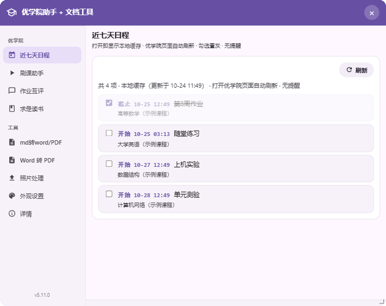
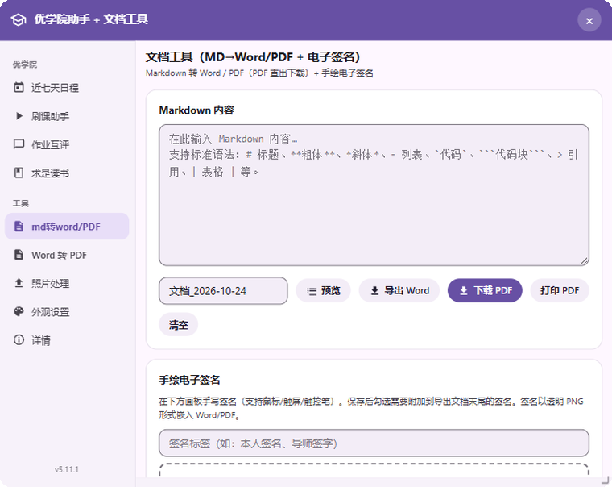
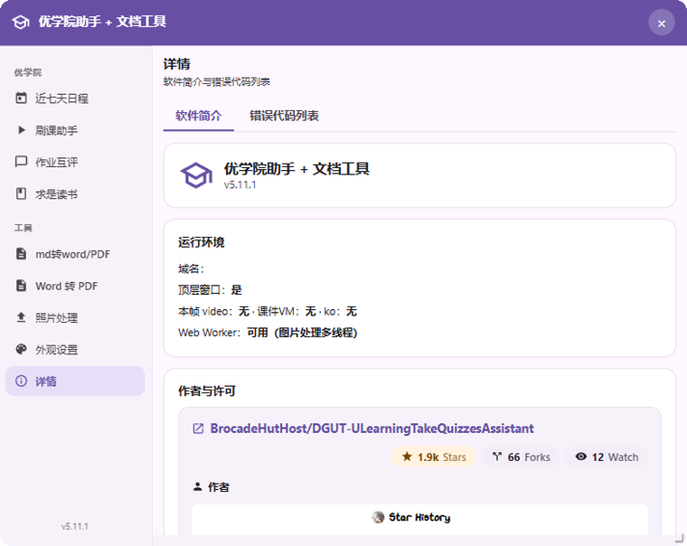

# DGUT 优学院助手 + 文档工具

> 一个专为东莞理工学院（DGUT）优学院平台编写的浏览器用户脚本。
>
> 学习功能：**近七天日程、视频倍速刷课、自动答题、题库导出、作业互评汇总、读书计时**。
> （标准版已移除课程签到功能，请各位同学诚信签到打卡。）
> 附加工具：**Markdown 转 Word / PDF、Word 转 PDF、图片压缩处理、手绘电子签名**。
>
> 所有文档与图片处理均在浏览器本地完成，内容不上传任何服务器。

<a href="https://www.star-history.com/?repos=brocadehuthost%2Fdgut-ulearningtakequizzesassistant&type=date&legend=top-left">
 <picture>
   <source media="(prefers-color-scheme: dark)" srcset="https://api.star-history.com/chart?repos=brocadehuthost/dgut-ulearningtakequizzesassistant&type=date&theme=dark&legend=top-left" />
   <source media="(prefers-color-scheme: light)" srcset="https://api.star-history.com/chart?repos=brocadehuthost/dgut-ulearningtakequizzesassistant&type=date&legend=top-left" />
   
 </picture>
</a>

## 近期更新

- 刷课倍速：倍速被站点重置时，用页面脚本强制改写。
- 图片工具：黑白改为转灰度图；锐化后自动控制文件大小。
- 求是读书按服务端阅读时长判定切书；「同步服务端」会同步本地与服务端时间，服务端刷新后也会自动同步。
- 日程支持本地缓存：成功拉取后保存一份，之后不在优学院页面或暂时未登录也能先看上次日程。
- 任意窗口都可使用已授权的登录状态刷新日程。
- 标准版移除课程签到功能，请通过学校官方渠道诚信签到。
- 修复刷课倍速设置、换页播放等问题。
- 新增面板靠边吸附与一键更新。

> **更新方式**：面板「详情页 → 作者与许可」→「立即检查」，发现新版本后点「立即更新」并在脚本管理器中确认；也可以直接重新安装 `理工小助手.user.js`。

---

## 功能截图

> 以下为脚本真实界面模拟，课程名称、时间、GitHub 数据等均为演示用虚构内容。

### 近七天日程

### 文档工具

### 详情页

---

## 功能一览

| 模块 | 能做什么 | 状态 |
|------|---------|------|
| 近七天日程 | 只读显示近 7 天事项；勾选后置灰，过期自动清理，不分类、不提醒 | 正常 |
| 刷课助手 | 视频自定义倍速播放、自动答题、自动翻页、题库收集与导出 | 正常 |
| 作业互评 | 在互评详情页读取数据、还原评价人身份、汇总记录并筛选 | 正常 |
| 求是读书 | 按书目累计阅读时长，满 4 小时 10 分自动翻页、切书 | 正常 |
| 文档工具 | Markdown 转 Word / PDF，手绘电子签名附加到导出文档 | 正常 |
| Word 转 PDF | 本地解析 .docx 并导出 PDF / .doc | 持续优化 |
| 图片工具 | 缩放、压缩到指定大小、增大文件、锐化、灰度、亮度均匀 | 正常 |
| 外观设置 | 亮色 / 深色 / 跟随系统主题，六种预设色加自定义颜色 | 正常 |
| 主题美化扩展（可选） | 纳西妲主题皮肤：白绿配色、面板背景、金丝描边、四叶草点缀 | 可选 |

---

## 安装指南

1. **安装用户脚本管理器**
   在浏览器扩展商店中，任选一款支持用户脚本的管理器扩展安装即可。

2. **添加脚本**
   在管理器中新建脚本，将本脚本的完整代码粘贴进去。

3. **保存并启用**
   保存后确认脚本处于启用状态。

4. **开始使用**
   打开任意网页，页面右下角会出现悬浮图标，点击即可展开操作面板。

> 面板在所有网页都能打开，方便随时使用工具箱；日程、刷课等学习功能需要在优学院或 DGUT 相关页面才生效。
>
> 首次使用文档相关功能时需要联网加载必要组件，之后有缓存。

---

## 使用说明

### 面板通用操作

- **展开 / 收起**：点击右下角悬浮球展开面板，再次点击收起。
- **移动位置**：按住面板顶部标题栏拖动，位置自动记忆。
- **拖丢了怎么办**：在脚本管理器中本脚本的菜单命令里选择「重置面板/悬浮面板位置」即可恢复默认位置。
- **快捷入口**：脚本管理器菜单里为每个功能都提供了直接跳转命令。

### 近七天日程

进入优学院页面，打开面板中的「近七天日程」：

1. **自动读取**：打开视图即读取近 7 天日程，按时间升序平铺显示，不分类、不筛选。
2. **勾选置灰**：点任意一项的复选框即标记完成并置灰；勾选状态只保存在本地。
3. **过期自动清理**：过了截止时间的项会自动从列表移除，不会提醒、不会弹窗。
4. **本地缓存**：成功拉取后自动保存一份，之后即使不在优学院页面或暂时未登录，打开也能先看到上次的日程。
5. **刷新**：点「刷新」可手动重新拉取。

> 本脚本已移除课程签到功能，请各位同学诚信签到打卡，签到请走学校官方渠道。

### 刷课助手

进入包含视频的课件页，打开面板中的「刷课助手」：

1. **设置参数**：视频倍速（默认 6 倍，范围 1-16，建议 6-10）、是否自动答题、是否自动翻页、是否收集题库。
2. **启动**：点击「启动」，脚本自动以设定倍速播放视频，遇到题目时尝试作答，看完自动翻页。
3. **导出题库**：答题过程中题目与答案自动缓存到本地；点击「导出题库」生成 Word 文档用于复习。
4. **清空题库**：点击「清空题库」清除本地缓存（不可恢复）。

说明：

- 倍速守卫会在平台重置倍速时尽量保持设定值。
- 自动答题遇到未知题型会跳过，不会盲点。
- 自动关闭答题统计等弹窗，尽量不打断流程。

### 作业互评

进入作业互评详情页，打开面板中的「作业互评」：

1. **扫描当前作业**：读取互评数据，还原评价人的姓名与班级，并在页面上标注「评价人 / 待评价人」。
2. **查看记录**：以卡片形式展示评价人、分数、评语、班级与时间。
3. **筛选**：按姓名 / 学号搜索，或按分数区间筛选（写法如 `80-95`、`>90`、`<80`）。
4. **清空记录**：清除本地保存的全部互评记录。

### 求是读书

进入求是读书课件页，打开面板中的「求是读书」：

1. **开始 / 暂停**：开始后按书目累计阅读时长；暂停则停止统计。默认不会自动开始。
2. **翻页间隔**：设置自动翻页的秒数（默认 30 秒 / 页），保存后同步给页面内的阅读器。
3. **同步服务端**：把本地时间与服务端时间对齐；服务端时间刷新后也会自动同步。
4. **自动切书**：服务端阅读时长满 4 小时 10 分后自动翻页并切换下一本书，全部读完会提示。

### 文档工具

打开面板中的「文档工具」：

1. **输入 Markdown**：在文本区输入内容，支持标题、粗体、列表、代码块、表格、引用等常用语法；内容自动保存草稿。
2. **预览**：点击「预览」实时查看渲染效果。
3. **导出 Word**：生成 `.doc` 文件，Word / WPS 可直接打开与二次编辑。
4. **下载 PDF**：本地生成 A4 多页 PDF 并直接保存，不需要经过打印对话框。生成需要几秒，大文档稍长。
5. **打印 PDF**：打开打印视图，在打印对话框中选择「另存为 PDF」。文字为矢量、体积更小。
6. **手绘电子签名**：
   - 在画板上手写（支持鼠标 / 触屏 / 触控笔）；
   - 填写标签后保存，可保存多份；
   - 勾选的签名会附加到导出文档末尾；
   - 可随时删除或重画。

### Word 转 PDF

打开面板中的「Word 转 PDF」：

1. 选择 `.docx` 文件（Word 2007 及以上格式；旧版 `.doc` 请先另存为 `.docx`）。
2. 可选三种输出：**下载 PDF**、**打印 PDF**、**导出为 .doc**。
3. 选择文件后自动解析并预览内容。

> 注意：复杂排版、特殊字体或表格可能出现样式偏差或分页不理想，属已知限制，后续版本持续优化。

### 图片工具

打开面板中的「照片处理」：

1. **选择图片**：载入 JPG / PNG / WebP 等常见格式。
2. **缩放**：不缩放、按百分比、或按像素尺寸；适配方式支持包含、覆盖、拉伸。
3. **平滑**：
   - 高质量（推荐）：减少压缩后的毛糙、锯齿和摩尔纹；
   - 标准：浏览器默认效果；
   - 关闭：适合像素风或需要硬边的场景。
4. **图像处理**：锐化、灰度（不是二值化）、亮度均匀。
5. **输出**：
   - 格式：保持原格式，或转为 JPEG / PNG / WebP；
   - 压缩到目标大小：填 KB 数后自动调节质量；
   - 增大到：把文件填充到指定大小。
6. **预览与下载**：先「预览效果」确认，再「处理并下载」保存。

### 外观设置

打开面板中的「外观设置」：

- **主题模式**：亮色 / 暗色 / 跟随系统。
- **主体色**：紫罗兰、蔚蓝、松石、青绿、琥珀、玫红六种预设，也可用取色器自定义。
- 设置自动保存并立即生效。

### 详情页

打开面板中的「详情」：

- 软件简介、版本、作者与许可、功能一览。
- GitHub 项目卡片：Star / Fork / Watch、作者与贡献者头像、最近更新时间。
- 更新检查入口。

---

## 主题美化扩展（可选）

> **普通用户无需安装美化包**，主脚本自带界面功能完整、开箱即用；美化包只是把界面换成其他主题，不影响任何功能。

### 安装美化包

美化包文件：`小助手UI主题美化扩展-纳西妲主题.js`

前置条件：先安装并启用主脚本，然后按照相同步骤安装并启用美化脚本。

1. 下载美化包文件。
2. 打开用户脚本管理器，新建一个脚本。
3. 删除默认模板内容，粘贴美化包的完整代码。
4. 保存并保持启用。
5. 打开任意网页，展开面板即可看到纳西妲主题。

说明：

- 美化包依赖主脚本运行；未安装主脚本时，美化包不会生效。
- 美化包只改变外观，不替换主脚本的功能逻辑。
- 主脚本升级后通常仍然可用。

### 卸载与兼容

- 在脚本管理器中停用或删除美化包，界面即恢复为主脚本默认外观，功能不受影响。
- 美化包与主脚本相互独立；若主脚本大改界面结构，美化包可能需要一并更新。

---

## 数据与隐私

- 文档内容、图片、签名等全部在浏览器本地处理，不上传任何服务器。
- 配置、题库、日程列表缓存与勾选状态、互评记录、签名保存在脚本管理器存储和浏览器本地存储中。
- 清除浏览器数据或重装脚本管理器会导致这些数据丢失，重要内容请及时导出。

---

## 常见问题 (FAQ)

**Q: 签到功能去哪了？**
A: 标准版已移除课程签到功能，请各位同学诚信签到打卡，签到请走学校官方渠道。

**Q: 日程可以手动添加吗？**
A: 不能。日程只读显示近 7 天事项，不手工导入、不分类、不带提醒；勾选状态与过期清理都只在本地完成。

**Q: 刷课倍速设置后没有生效？**
A: 先确认已点击「启动」，倍速守卫只在刷课助手运行中生效。若启动后仍不变速，请升级到当前版本并刷新课件页；仍无法解决时可打开详细日志后反馈。

**Q: 自动答题会盲点吗？**
A: 不会。未知题型一律跳过，取不到答案就不作答。

**Q: PDF 直接下载和打印 PDF 有什么区别？**
A: 「下载 PDF」直接保存，不走打印对话框，但体积可能稍大；「打印 PDF」走打印视图另存，文字为矢量、体积更小。Word 转 PDF 的样式还原度目前有限，后续会优化。

**Q: 图片压缩后为什么显得毛糙？**
A: 把「平滑」设为「高质量」，并降低锐化强度或关闭锐化；压缩比过大时勾选「允许降低分辨率」让脚本逐步缩小尺寸，画质更自然。

**Q: 签名会丢失吗？**
A: 签名保存在本地存储中，清除浏览器数据或更换设备会丢失，重要签名建议导出到文档后另行保存。

**Q: 面板被拖到屏幕外找不到了？**
A: 在脚本管理器中本脚本的菜单命令里选择「重置面板/悬浮面板位置」，即可恢复默认位置。

**Q: 为什么所有网站都会出现悬浮球？**
A: 面板设计为全站可用，方便随时使用文档、图片等工具；日程、刷课等功能则只在优学院相关页面生效。

**Q: 首次使用文档相关功能为什么需要联网？**
A: 需要加载文档处理所需组件，加载一次后有缓存，之后离线也能使用已加载过的功能。

**Q: 我不想要美化包可以不安装吗？**
A: 可以。主脚本默认界面功能完整、开箱即用；美化包仅在你想要主题皮肤时才安装。

**Q: 安装了美化包会不会影响功能？**
A: 不会。美化包只改变配色、背景、描边、粒子等外观，不改动功能逻辑；可随时停用以恢复默认外观。

**Q: 美化包安装后没有生效？**
A: 请依次确认：主脚本已安装并启用；美化包已保存并启用；打开面板查看，必要时在美化包菜单中确认「切换面板背景」处于「开」。

---

## 后续可能的美化方向

以下为可能的演进方向，均为纯外观层面，不影响核心功能：

- 多主题皮肤：提供更多角色 / 风格主题，支持一键切换。
- 内置色彩方案：把主色、描边、背景等做成可视化选项。
- 更精细的暗色模式：优化对比度、图片层次与描边亮度。
- 统一图标与字体：提升整体一致性。
- 布局变体：紧凑版 / 宽屏版面板。
- 动效增强：更自然的过渡、悬停与加载动效（可开关）。

---

## 免责声明与开源许可

本脚本仅供学习交流与自动化测试使用，请勿用于任何商业或违规用途。使用本脚本产生的一切后果由使用者自行承担。

本项目采用 **AGPL-3.0-only** 许可。你可以自由使用、学习、修改本脚本；修改后再分发或以网络服务形式提供时，必须公开源代码并沿用相同许可；分发时需保留原作者署名与许可声明。完整许可文本见 [gnu.org/licenses/agpl-3.0](https://www.gnu.org/licenses/agpl-3.0.html)。
